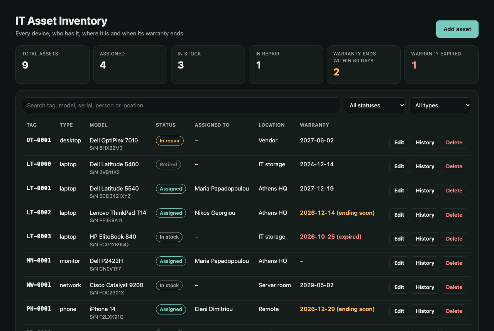

# IT Asset Inventory

A small web application for keeping track of IT equipment: every device, who has it, where it is and when its warranty ends. Keeping an asset inventory accurate is part of my job in IT support, so this is a problem I know from the user's side.



## What it does

- Add, edit and delete assets (laptops, desktops, monitors, phones, printers, network devices)
- Track status: in stock, assigned, in repair, retired
- Search by tag, model, serial number, person or location, and filter by status and type
- Dashboard numbers, including warranties that end within 60 days or have already expired
- A history for each asset: every assignment, move and change is recorded with its time

## How it is built

| Part | Technology |
| --- | --- |
| Back end | Python 3 (standard library only: `http.server`, `sqlite3`, `json`) |
| Database | SQLite, structure in `schema.sql` |
| Front end | HTML, CSS and JavaScript, talking to the back end with `fetch()` |
| Tests | `unittest`, covering the database layer and the HTTP API |

There is nothing to install: no frameworks and no packages.

```
app.py              web server and JSON API
db.py               all SQL lives here
schema.sql          tables and indexes
static/             the page (index.html, app.js, style.css)
test_inventory.py   tests
```

### The API

| Method | URL | Purpose |
| --- | --- | --- |
| GET | `/api/assets?q=&status=&type=` | List assets, with optional filters |
| POST | `/api/assets` | Create an asset |
| PUT | `/api/assets/<id>` | Update an asset |
| DELETE | `/api/assets/<id>` | Delete an asset |
| GET | `/api/assets/<id>/history` | History of one asset |
| GET | `/api/summary` | Dashboard numbers |

### Things I paid attention to

- **SQL injection:** every query uses `?` placeholders, so user input is never part of the SQL text. There is a test for it.
- **Validation on the server:** the browser form helps, but the server checks everything again and returns clear error messages.
- **Audit trail:** a change and its history entry are written in one transaction, so they cannot get out of step.
- **Only known files are served:** the server sends three fixed files and nothing else, so a crafted URL cannot read other files.
- **Local only:** the app has no login, so it listens on `127.0.0.1` and is not reachable from the network.

## Run it

Requires Python 3.9 or newer.

```
python3 app.py
```

Open http://127.0.0.1:8000. The first run creates `inventory.db` with a few example devices. Use `--no-sample-data` to start empty, `--port` to change the port.

## Tests

```
python3 -m unittest -v
```

## Ideas for later

- User accounts and roles (needed before it could run on a real network)
- Import and export as CSV
- PostgreSQL instead of SQLite for more than one site
